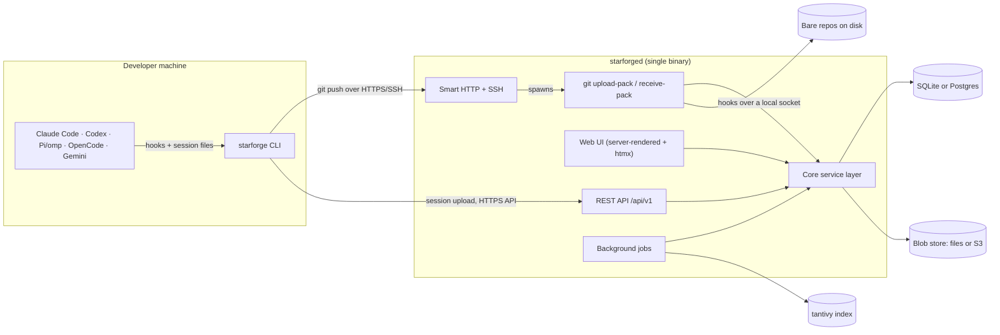
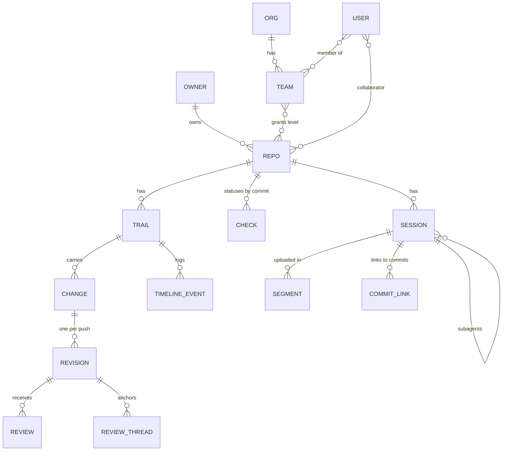

# Starforge v0.1 — Design

- **Date:** 2026-11-03
- **Status:** Approved section by section during brainstorming; this document is the written spec for review.
- **Scope:** System design for Starforge v0.1.0. Implementation is planned per milestone (§14): each milestone gets its own implementation plan, M0 first.

## 1. Summary

Starforge is an open-source, self-hostable git forge built around agent-assisted development. It:

- hosts git repositories over HTTP and SSH;
- replaces issues and pull requests with **Trails**: one object that carries the intent, the code changes, every revision, reviews, CI checks, merge gates, and the merge;
- captures **agent sessions** (prompts, transcripts, tool calls, token usage) from Claude Code, Codex CLI, Pi/omp, OpenCode, and Gemini CLI/Antigravity, and links them to commits, blame, and Trails.

It ships as two programs:

| Program | Role | License |
|---|---|---|
| `starforged` | Server: web UI, REST API, git over HTTP and SSH, background jobs. One binary; SQLite by default, Postgres optional. | AGPL-3.0-or-later |
| `starforge` | Developer CLI: session capture, git hooks, session upload, Trail commands. | MIT OR Apache-2.0 |

## 2. Goals and non-goals

### Goals (v0.1.0)

1. Host repositories: push and pull over smart HTTP (protocol v2) and SSH; browse code, history, diffs, and blame.
2. Trails as the only collaboration object: intent, changes, revisions, reviews, checks, gates, server-side merge.
3. Capture sessions from five agents with a Starforge-owned CLI and an open trace format; link sessions to commits and Trails; render them beside diffs and blame.
4. Users, orgs, teams, permission levels, branch and tag protection, OIDC single sign-on.
5. Import from any git URL; pull and push mirrors; GitHub metadata import (issues and PRs become Trails).
6. Single-binary deployment with SQLite by default and Postgres as a configuration change.
7. Enforced trace privacy: visibility rules, redaction, quarantine, deletion.

### Non-goals (v0.1.0)

- CI runners are opt-in (M6, additive supersession of D13): repositories
  without a runner keep the external-CI path (commit status API and
  webhooks, §10.4); runners and sandboxed agent execution are described in
  §14 M6.
- Git LFS.
- Forks, cross-repo changes, and multi-repo Trails. Contributors without write access use `refs/for` pushes (§8.2).
- Rebase-and-merge. Git's server-side `replay` is still experimental.
- Line-level AI-vs-human attribution, live streaming of in-progress sessions, session rewind/resume.
- Semantic (embedding) search and indexed code search.
- Package registries, wikis, pages, federation.
- Server-side agents or any LLM call made by the server.
- Third-party OAuth applications and passkeys.
- GitLab and Forgejo metadata import.
- Compatibility with Entire's checkpoint format or API. Entire is inspiration only.
- Windows as a server platform; high availability or multi-node deployment.
- Token cost estimates. v0.1 records token counts only.

## 3. Decisions

| # | Decision | Choice | Rationale |
|---|---|---|---|
| D1 | Purpose | Open-source product that the author also depends on | User requirement |
| D2 | Hosting | Starforge hosts repositories from v0.1 | User requirement |
| D3 | Capture | Own CLI and own open trace format; no Entire code, format, or API | User decision; Entire is inspiration only |
| D4 | Collaboration model | Trails replace issues and PRs; one repo per Trail | User decision; schema keeps an owner reference so multi-repo Trails can come later |
| D5 | Agents in v0.1 | Claude Code, Codex CLI, Pi/omp, OpenCode, Gemini CLI/Antigravity | User decision |
| D6 | Language | Rust for server and CLI | User decision; strongest trace-search stack (tantivy), production SSH (russh) |
| D7 | Deployment | Single binary, SQLite default, Postgres optional | User decision |
| D8 | License | Server AGPL-3.0-or-later; CLI, trace format, redaction, and adapters MIT OR Apache-2.0 | User decision; hosted forks must share changes, while agents and tools can embed the format freely |
| D9 | Trace visibility | Follow repo access; on public repos, only members see traces unless a maintainer publishes them | User decision |
| D10 | Architecture | Server-canonical monolith: traces and Trails in the database plus a blob store | Only option that enforces D9 and makes deletion real; fastest to v0.1 |
| D11 | Git engine | `git` subprocesses for the pack protocol, merges, and blame; gix for read paths | gitoxide has no production-ready server-side upload-pack/receive-pack |
| D12 | Web UI | Server-rendered (axum + askama) with htmx and one plain-JavaScript module for the session viewer | Single toolchain; no bundler |
| D13 | CI | No runners; external CI via a GitHub-compatible commit status endpoint and webhooks | User: CI runners are a separate concern |

> **M6 amendment (2026-11-06):** CI runners and sandboxed agent execution are an additive M6 milestone (plan: `docs/superpowers/plans/2026-11-06-starforge-m6-ci-sandboxes.md`). D13's external-CI path (statuses + webhooks) remains supported. Untrusted code runs only in external sandboxes; the server still executes no job code and makes no LLM calls.

## 4. Research basis

The brainstorming session ran a nine-item research review and a six-item adversarial verification (2026-11-03). Findings that shaped this design:

- **Entire is a hosted forge, not self-hostable.** Entire launched its forge ("The Git forge for agent-human collaboration") in late October 2026. Its only self-hosting commitment is to open-source its git storage layer, EntireDB, "in the coming months", a promise repeated since July 2026. That covers git storage only; Trails, review agents, search, and the UI stay hosted. The open gap is a self-hosted trace and collaboration layer.
- **Entire's checkpoint format changed three times in about six months** (a `v1` branch, an undocumented `v2/main` plus `v2/full/<generation>` ref layout, then one ref per checkpoint) and carries no format-version field. Starforge's format has explicit versioning (§7.8).
- **Transcripts are large.** One observed Entire session checkpoint was about 4 MB: 3.1 MB raw native transcript, 0.8 MB normalized transcript, 0.15 MB prompts. Starforge compresses, segments, stores blobs outside the database, and pages the viewer.
- **Entire moved its Trails out of git** into its own database in April 2026. Collaboration objects are server state; Starforge treats them the same way.
- **Prior art is immature.** agentlogs (FSL-1.1, v0.1.5) is a standalone session server with commit links; entire-local is a terminal viewer. No forge integrates sessions natively; GitLab Duo provides audit-grade agent records only.
- **Forgejo 17 and Gitea 28 have no plugin system and no agent features.** They accept and serve custom refs but ignore them in the UI and database, and push mirrors drop them. A fork was rejected because Trails replace the core issue and PR model.
- **Rust is viable for a forge.** gitoxide's server-side protocol is not production-ready (an upstream upload-pack PR was closed unmerged in August 2026), so Starforge shells out to `git` as Gitea does. russh 0.65 is in production use, and Tangled's in-progress Rust git server (knot2) shows Rust git serving is feasible. Rust has no mature embeddable OIDC provider library (oxide-auth covers OAuth2 only), so Starforge implements only the device flow for its own CLI and acts as an OIDC client, not a provider.

Sources:

- Entire docs index — https://docs.entire.com/llms.txt
- Entire checkpoint storage — https://docs.entire.com/guides/checkpoints/checkpoint-storage.md
- Entire self-hosting statements — https://entire.com/news/entire-launches-an-independent-git-forge-for-agent-human-collaboration, https://entire.com/blog/an-entirely-new-git-hosting-network, https://entire.com/blog/a-git-forge-without-a-center
- Entire CLI source (v0.12.2) — https://github.com/entireio/cli
- Forgejo v17 release — https://forgejo.org/2026-10-release-v17-0 ; Forgejo license change — https://forgejo.org/2024-08-gpl/
- gitoxide status — https://github.com/GitoxideLabs/gitoxide/blob/main/crate-status.md
- russh — https://crates.io/crates/russh
- Tangled knot2 — https://tangled.org/docs/upgrading/knot-2/
- agentlogs — https://github.com/agentlogs/agentlogs
- GitLab Duo Agent Platform — https://docs.gitlab.com/user/duo_agent_platform/
- Git protocol v2 — https://git-scm.com/docs/gitprotocol-v2

## 5. Architecture

### 5.1 Programs and crates

One Cargo workspace. Each crate has one job.

| Crate | Kind | License | Responsibility |
|---|---|---|---|
| `starforge-format` | lib | MIT OR Apache-2.0 | Trace Format v1 types, JSON Schema, version handling (§7.8) |
| `starforge-redact` | lib | MIT OR Apache-2.0 | Redaction engine used by the CLI and the server (§7.4) |
| `starforge-capture` | lib | MIT OR Apache-2.0 | Agent adapters: discovery, hooks, incremental native-to-v1 normalization (§7.1) |
| `starforge-cli` | bin `starforge` | MIT OR Apache-2.0 | Developer CLI (§10.3) |
| `starforged-core` | lib | AGPL-3.0-or-later | Domain and service layer: accounts, permissions, repos, Trails, sessions. The only path to stored state. |
| `starforged-db` | lib | AGPL-3.0-or-later | sqlx data access; one schema for SQLite and Postgres; embedded migrations |
| `starforged-git` | lib | AGPL-3.0-or-later | `git` subprocess wrappers (pack protocol, merge-tree, blame, grep); gix for refs, trees, blobs, history |
| `starforged-ssh` | lib | AGPL-3.0-or-later | Embedded SSH server (russh) dispatching to `git` |
| `starforged-web` | lib | AGPL-3.0-or-later | axum routes, askama templates, htmx, static assets, session viewer module |
| `starforged-api` | lib | AGPL-3.0-or-later | REST `/api/v1`, OpenAPI 3.1 (utoipa), webhooks |
| `starforged-jobs` | lib | AGPL-3.0-or-later | Database-backed job queue and workers |
| `starforged-blob` | lib | AGPL-3.0-or-later | Content-addressed blob store (BLAKE3); filesystem and S3-compatible backends |
| `starforged-index` | lib | AGPL-3.0-or-later | tantivy index over Trails and session turns |
| `starforged` | bin `starforged` | AGPL-3.0-or-later | Composition root: config, startup, subcommands |

The web UI and the REST API both call `starforged-core`; neither touches the database directly. A separate web client can be added later without moving logic.

### 5.2 Process model



One tokio process runs the HTTP server (web UI, API, smart HTTP), the SSH server, and job workers. Pack negotiation and pack transfer run in `git` child processes.

### 5.3 Data directory

```
data/
  starforge.db            # SQLite (absent when Postgres is configured)
  repos/<shard>/<repo-id>.git
  blobs/<hash[0..2]>/<hash>   # filesystem blob backend
  index/                  # tantivy (rebuildable)
  run/starforged.sock     # internal socket for git hooks
  tmp/
```

Repositories are stored by numeric ID, sharded by the ID's last two digits. Renames and transfers change only database rows.

### 5.4 Git hooks and the internal socket

Every hosted repository has `pre-receive` and `post-receive` hooks that exec `starforged hook <name>`. `git` runs these hooks with environment variables the server sets when spawning `receive-pack`: `STARFORGE_REPO_ID`, `STARFORGE_PUSHER_ID`, and a one-time `STARFORGE_PUSH_TOKEN`. The hook process connects to `data/run/starforged.sock`, authenticates with the push token, and asks the server to authorize ref updates (pre-receive) or to enqueue follow-up work (post-receive). Messages for the pusher go back through git's sideband (`remote: …`).

### 5.5 Platforms

- `starforged`: Linux x86_64 and aarch64 in production; macOS for development.
- `starforge`: Linux, macOS, Windows.
- Runtime dependency of `starforged`: system `git` 2.38 or newer.

## 6. Data model



### 6.1 Identity and access

- **Owners.** Users and orgs share one handle namespace; repository URLs are `/<owner>/<repo>`.
- **Users:** handle, display name, emails (verified flag), password hash (argon2id; absent for SSO-only accounts), TOTP secret (optional), site-admin flag, state (`active`, `suspended`).
- **Orgs:** handle, display name, owners, members, and a base permission (`none`, `read`, `write`) that org members get on all org repos.
- **Teams** belong to an org and grant one permission level on all org repos or on a selected set.
- **Collaborators** are direct per-repo grants to users.
- **Permission levels:** `read` < `triage` < `write` < `maintain` < `admin`. A user's effective level on a repo is the highest of: org ownership (admin), org base permission, team grants, collaborator grant, and implicit read on public repos (and on internal repos for signed-in users).
- **Repo member:** a user with at least one explicit grant on the repo (collaborator, team, org base permission, or org ownership). Implicit public read does not make a user a member.
- **Repo visibility:** `public`, `internal` (any signed-in user), `private`.

| Capability | read | triage | write | maintain | admin |
|---|---|---|---|---|---|
| Fetch, browse, open Trails, comment, submit non-counting reviews | ✓ | ✓ | ✓ | ✓ | ✓ |
| Push `refs/for` changes (subject to the repo setting in §8.2) | ✓ | ✓ | ✓ | ✓ | ✓ |
| Edit labels and assignees; close and reopen Trails | | ✓ | ✓ | ✓ | ✓ |
| Push branches and tags; approvals count toward gates; merge | | | ✓ | ✓ | ✓ |
| Publish and unpublish sessions; protection rules; gates; webhooks; mirrors | | | | ✓ | ✓ |
| Collaborators; visibility; rename, transfer, archive, delete; release or purge quarantined sessions | | | | | ✓ |

- **Credentials:** SSH keys (per user); deploy keys (per repo, read-only or read-write); personal access tokens (scopes `repo:read`, `repo:write`, `trail:write`, `session:upload`, `admin`; expiry required; stored as SHA-256 of a 256-bit random token); CLI OAuth tokens (access token lifetime 1 hour; rotating refresh tokens, lifetime 90 days).

### 6.2 Trails

- **Trail:** repo, per-repo number, title, intent (Markdown), state (`open`, `merged`, `closed`), `ready` flag, author, labels, assignees, created/updated/closed/merged timestamps. A Trail with no changes behaves like an issue. A Trail is `merged` when all of its non-closed changes are merged.
- **Change:** Trail, per-Trail number `k`, kind (`branch`, `agit`, `imported`), head branch (kind `branch` only), base branch, current revision, state (`open`, `merged`, `closed`), merge method and merge commit when merged, creator. The server maintains `refs/trails/<n>/changes/<k>/head`.
- **Revision:** change, per-change number `r`, head SHA, base SHA, merge-base SHA, pusher, timestamp, mergeability (`unknown`, `clean`, `conflict` with the conflicting paths). Each revision is kept reachable at `refs/trails/<n>/changes/<k>/rev/<r>`. A new revision is created when an `agit` change receives a push, or when the head branch of a `branch` change moves.
- **Review:** change, revision, author, verdict (`comment`, `approve`, `request_changes`), body (Markdown), optional session reference (the agent session that produced the review), state (`pending`, `submitted`, `dismissed`).
- **Review thread:** change, anchoring revision, path, side (`base`, `head`), start and end line, resolved flag. Threads whose anchor lines no longer exist in the current revision display as outdated. **Review comment:** thread, optional review, author, body.
- **Trail comment** and **timeline event** (kind, actor, JSON payload, timestamp) record the Trail's history: comments, state changes, revisions, linked sessions, reviews, checks, merges.
- **Check:** repo, commit SHA, context name, state (`pending`, `success`, `failure`, `error`), target URL, description, creator. The latest status per (SHA, context) is current.
- **Gate rules** attach to a branch-protection pattern and apply to changes targeting matching base branches:
  - required approvals (count; only approvals from users with `write` or above count);
  - dismiss approvals when a new revision arrives (bool);
  - block on any outstanding `request_changes` (bool, default true);
  - required check contexts (all must be `success` on the head SHA);
  - require head up to date with base (bool);
  - require all threads resolved (bool);
  - require session evidence (bool): every commit in the change carrying a `Starforge-Session` trailer has that session uploaded to this repo (in any lifecycle state) and not quarantined;
  - allowed merge methods (subset of `merge`, `squash`, `fast_forward`).
- **Merge** is executed by the server (§8.4).

### 6.3 Sessions

- **Session:** identity is (repo, ULID); the ULID is generated by the CLI so commit trailers can be written before upload. Fields: uploader, agent name and version, models, title, branch and head SHA at start, start and end times, parent session (subagents), token totals (input, output, cache read, cache write, reasoning), files touched, turn count, tool-call count, lifecycle state (`receiving`, `complete`), quarantine state (`none`, `quarantined` with reason, `released`), visibility (`inherit`, `published`), raw-transcript flag, redaction rule fingerprint and counts, capture mode (`hook`, `discovery`), adapter version status (`verified`, `unverified`), CLI version.
- **Segment:** session, number `n`, first and last event sequence numbers, normalized-transcript blob, raw-transcript blob (optional), byte size, BLAKE3 hash, upload time. Sessions grow over time; each upload adds segments.
- **Commit link:** session, commit SHA, source (`trailer`, `cli_claim`), confidence (`exact`, `heuristic`), event-sequence range that produced the commit (optional). A link is recorded from whichever arrives first, the commit (trailer scan) or the upload (CLI claim), and becomes resolved when both exist.
- **Trail link:** a session is linked to a Trail through commits in the Trail's changes, or explicitly by a user.
- Individual turns are stored only in segment blobs. The database stores summary fields; the search index stores per-turn text.
- An agent session that produced commits in two repositories is uploaded to each repository as a separate record with the same ULID. Blob storage deduplicates identical content.
- Attribution in v0.1 is commit-level: blame line → commit → linked sessions.
- **Blob:** BLAKE3 hash, size, reference count, backend key. Purging decrements reference counts; blobs at zero references are deleted by a job.

### 6.4 Session access rules

- **Read.** A user can read a session when all of these hold:
  1. the user can read the repo;
  2. the repo is not public, **or** the session is published, **or** the user is a repo member;
  3. the session is not quarantined, **or** the user is its uploader or a repo admin.
- **Upload.** Repo members with `write` or above may upload sessions. Other users may upload sessions to a repo only while they author an open change on one of its Trails. Uploads count against per-user and per-repo quotas (§11.6).
- **Publish.** On public repos, users with `maintain` or `admin` can publish and unpublish sessions. Publishing has no effect on non-public repos, where sessions already follow repo access.
- **Delete.** The uploader, repo admins, and site admins can delete a session (§11.5).

### 6.5 Audit log

Append-only records of logins (success and failure), password and 2FA changes, token creation and revocation, permission and membership changes, visibility changes, session publish/unpublish/quarantine/release/purge/delete, and site-admin actions. Each record stores actor, action, target, IP, user agent, and timestamp. Records never contain transcript content.

### 6.6 Identifiers

64-bit integer primary keys internally; ULIDs for sessions; per-repo sequence numbers for Trails, starting at 1 and shared by all Trails in the repo.

## 7. Trace capture and ingest

### 7.1 Agent adapters

Each agent has an adapter in `starforge-capture` implementing:

- `detect`: whether the agent is installed;
- `install_hooks` / `remove_hooks`: optional live-capture integration;
- `discover`: native sessions whose working directory lies inside a given worktree and that changed since a given cursor;
- `read`: parse a native transcript incrementally from a cursor into Trace Format v1 events, returning the new cursor.

**The agent's native transcript is the source of truth.** Hook mode adds exact turn boundaries, timing, and session start/end events; discovery mode finds sessions at commit time by working directory and modification time. Capture correctness never depends on hooks.

| Agent | Native session store | Live capture |
|---|---|---|
| Claude Code | `~/.claude/projects/<slug>/<id>.jsonl` plus subagent files | Hooks in Claude Code settings |
| Codex CLI | `~/.codex/sessions/YYYY/MM/DD/rollout-*.jsonl` | Hooks where the installed version provides them; otherwise discovery |
| Pi / omp | JSONL session files (Pi's documented session format; omp under `~/.omp/agent/sessions/`) | Pi/omp extension events |
| OpenCode | `opencode.db` (SQLite) or file storage, by version | OpenCode plugin events |
| Gemini CLI / Antigravity | `~/.gemini/tmp/<hash>/chats/` (Gemini CLI); Antigravity CLI store per its installed version | Hooks where the installed version provides them; otherwise discovery |

Native formats are unpublished or drift between versions. Each adapter declares the agent versions covered by its golden fixtures (§13). For any other version it parses with the closest known parser and marks the session `unverified`; when the repository stores raw transcripts, the server re-normalizes them after the adapter is updated.

Because adapters live in an MIT crate shared with the server, the server can re-derive normalized transcripts from stored raw transcripts after an adapter improves.

### 7.2 Commit linking

`starforge enable` installs `prepare-commit-msg`, `post-commit`, and `pre-push` git hooks in the local repository, chaining any existing hooks, and installs agent hooks for detected agents. It prints every file it changes. `starforge disable` reverses both.

At `prepare-commit-msg`:

1. Collect sessions active in this worktree since each session's last link: from hook events, plus `discover`.
2. Read each session from its cursor; collect the files it edited since its last link (from edit, write, and patch tool calls).
3. Link a session when its edited files overlap the staged files (confidence `exact`). Link a session with no file-level data that was active since the previous commit in this worktree as a claim (confidence `heuristic`).
4. Append one `Starforge-Session: <ULID>` trailer per linked session.

At `post-commit`, record the commit SHA and the event-sequence range against each linked session in the spool.

`starforge link <session> [<commit>]` and `starforge unlink <session> <commit>` correct links. Trailers survive amend, rebase, and cherry-pick because they are part of the commit message.

### 7.3 Local spool

All pending data lives in `<git common dir>/starforge/`, never in the working tree, and is shared by all worktrees of the repository:

```
starforge/
  sessions/<ULID>/meta.json
  sessions/<ULID>/segments/<n>.jsonl.zst      # normalized, redacted
  sessions/<ULID>/raw/<n>.zst                 # raw native slice, redacted
  cursors.json
  links.jsonl
  queue.jsonl
```

### 7.4 Redaction

`starforge-redact` runs on the client before anything is written to the spool, and again on the server at ingest. Rules:

- built-in detectors: private keys, cloud-provider credentials, tokens with known prefixes, credentialed URLs, connection strings, high-entropy strings, `Authorization` header values; optional email and phone detection;
- repository rules in `.starforge/redact.toml` and site-wide rules in server configuration. Rules are declarative: regular expressions, literal strings, and entropy thresholds. Rules never reference executables, so cloning a repository cannot cause code execution.

Redaction is JSON-aware for JSONL content (values are redacted; structure is preserved). Each session records the rule-set fingerprint and per-detector counts.

### 7.5 Upload protocol

- `PUT /api/v1/repos/{owner}/{repo}/sessions/{ulid}` — create or update session metadata.
- `PUT /api/v1/repos/{owner}/{repo}/sessions/{ulid}/segments/{n}` — upload segment `n`: zstd-compressed normalized JSONL, plus the raw slice when the repo stores raw transcripts. Idempotent: re-uploading identical content (same BLAKE3) succeeds without change; different content for an existing `n` is rejected with `409`.
- `POST /api/v1/repos/{owner}/{repo}/sessions/{ulid}/complete` — mark the session complete. The CLI calls it when the adapter reports that the session ended (a session-end hook or equivalent), or at the next sync after 24 hours without new events.
- `POST /api/v1/repos/{owner}/{repo}/sessions/{ulid}/links` — submit CLI commit claims.
- Segment size limit: 16 MiB compressed by default (server-configurable). The CLI splits larger slices.

Triggers: the `pre-push` hook enqueues uploads and attempts them without blocking the push; `starforge sync` uploads on demand; failures retry with exponential backoff on the next trigger. A push never fails because of a session upload.

### 7.6 Server discovery and CLI authentication

- `starforge auth login <server>` runs the OAuth 2.0 device authorization grant (RFC 8628) against `POST /api/v1/oauth/device/code` and `POST /api/v1/oauth/token`, then stores the tokens in the OS keychain, falling back to `~/.config/starforge/credentials.toml` with mode `0600`.
- `STARFORGE_TOKEN` supplies a personal access token for CI and headless agents.
- The CLI finds the server for a repository by checking each git remote's host for `GET /.well-known/starforge.json` (`{"starforge": "<version>", "api_url": "<url>", "ssh_url": "<url>"}`), or from `starforge.server` and `starforge.repo` in `.git/config`. Explicit configuration covers repositories whose upstream is another forge and which Starforge only mirrors.

### 7.7 Server ingest

1. **Authorize** under §6.4 and enforce quotas and rate limits.
2. **Validate** format version, segment numbering, hash, and size.
3. **Re-scan** with server and repository rules. A high-confidence hit (private key, cloud credential, token with a known prefix) sets the session to `quarantined`, records the detector and location, and notifies the uploader and repo admins. Repo admins can release it or purge it.
4. **Store** blobs in the blob store and rows in the database.
5. **Enqueue jobs:** index the new events, resolve commit links, update session statistics, emit webhooks.

### 7.8 Trace Format v1

Published as a written specification under `docs/format/` and implemented by `starforge-format`.

**Session metadata (JSON):**

| Field | Type | Notes |
|---|---|---|
| `format` | string | `"starforge.session/v1"` |
| `id` | string | ULID |
| `agent` | object | `{name, version}`; names: `claude-code`, `codex`, `pi`, `opencode`, `gemini` |
| `models` | string[] | Models observed in the session |
| `title` | string? | Agent-provided title or first prompt excerpt |
| `started_at`, `ended_at` | RFC 3339 | `ended_at` absent while receiving |
| `repo` | object | `{remote_urls[], branch, head_at_start}` |
| `parent_id` | string? | Parent session ULID for subagents |
| `usage` | object | `{input, output, cache_read, cache_write, reasoning}` totals |
| `files_touched` | string[] | Repo-relative paths |
| `redaction` | object | `{fingerprint, counts{detector: n}}` |
| `capture` | object | `{mode: "hook" or "discovery", cli_version, adapter_version_verified: bool}` |

**Events (JSONL, one per line):** common fields `v` (format major, `1`), `seq` (monotonic per session), `ts` (RFC 3339), `kind`, optional `id` and `parent`.

| `kind` | Additional fields |
|---|---|
| `user_message` | `text` |
| `assistant_message` | `text`, `model`, `usage{input, output, cache_read, cache_write, reasoning}` |
| `reasoning` | `text` (may be empty when the agent stores only a summary) |
| `tool_call` | `tool{name, input}` |
| `tool_result` | `result{output, is_error, truncated, original_bytes}` |
| `file_change` | `path`, `change` (`add`, `modify`, `delete`, `rename`), `diff` (unified, optional) |
| `compaction` | `summary` (optional) |
| `subagent_start`, `subagent_end` | `subagent_id`, `task` |
| `system` | `text` |

**Evolution rules:** adding optional fields or new `kind` values does not change `v`; readers ignore unknown fields and kinds. Removing or retyping a field, or changing a field's meaning, requires `v: 2`. The server reads every published major version indefinitely. The redacted raw native transcript is stored alongside normalized events unless the repository disables raw storage.

### 7.9 Export and import

`starforge export --repo <owner>/<repo> [--session <ulid>…] <dir>` writes session bundles (metadata JSON, normalized segments, raw segments, commit links) that a user can read. `starforge import <dir>` uploads bundles to a server through the normal upload API.

## 8. Git hosting

### 8.1 Transports

- **Smart HTTP** at `/<owner>/<repo>.git/info/refs`, `/git-upload-pack`, `/git-receive-pack`: spawns `git upload-pack --stateless-rpc` or `git receive-pack --stateless-rpc`, streams request and response bodies, passes the `Git-Protocol` header through (protocol v2), and accepts gzip request bodies. Public repositories allow anonymous fetch; internal and private repositories require authentication. Credentials are HTTP Basic with a personal access token or OAuth token as the password.
- **SSH** (russh) on port 2222 by default: public-key authentication against user keys and deploy keys; only `git-upload-pack`, `git-receive-pack`, and `git-upload-archive` are accepted; no shell, no port forwarding; per-connection idle and total timeouts and per-user connection limits.

### 8.2 Ref policy

Enforced in `pre-receive` through `starforged hook`:

| Ref | Who can push | Effect |
|---|---|---|
| `refs/heads/*` | `write`, subject to branch protection (block direct push, force-push, deletion; push allow-lists; require changes through a Trail) | Normal branches. Moving the head branch of a `branch` change creates a revision. |
| `refs/tags/*` | `write`, subject to optional tag protection | Normal tags |
| `refs/for/<base>[/<topic>]` | Users with `read` when the repository setting `refs_for_access` is `anyone_with_read` (the default); only repo members when it is `members` | Creates or updates an `agit` change. `-o trail=<n>` targets an existing Trail; otherwise a new Trail is created with `-o title=<text>` or the first commit's subject. Pushing again with the same `<base>/<topic>` from the same user updates the same change. The `refs/for` ref itself is not stored. |
| `refs/trails/*` | Server only | Change heads and revisions |
| Any other namespace | Rejected unless a site admin allow-lists the namespace | — |

Git's receive quarantine keeps pushed objects out of the repository until `pre-receive` accepts the push. `post-receive` enqueues: revision creation, mergeability recomputation, scanning new commits for `Starforge-Session` trailers, webhooks, and push mirrors.

### 8.3 Fetching Trail refs

`refs/trails/*` is not fetched by default clones (protocol v2 clients request only the prefixes in their refspecs). `starforge trail checkout <n> [--change <k>] [--rev <r>]` fetches the needed ref explicitly.

### 8.4 Server-side merge

1. `git merge-tree --write-tree <base> <head>` computes the result tree or the conflict list in the bare repository, with no working tree.
2. `git commit-tree` creates the commit:
   - `merge`: a merge commit with parents base and head;
   - `squash`: a single commit on base whose message is the Trail title and number, followed by the squashed commits' subjects and every distinct `Starforge-Session` trailer from them;
   - `fast_forward`: allowed only when head contains base; no new commit.
3. `git update-ref <base-ref> <new> <old>` moves the base branch only if it still points at `<old>`; otherwise the merge is retried against the new base or reported as conflicted.
4. Merge and squash commits created by the server carry a `Starforge-Trail: <owner>/<repo>#<n>` trailer.

Mergeability is recomputed after every new revision and every movement of the base branch.

### 8.5 Repository lifecycle

- Create (empty, or with an initial README), rename and transfer (database only), archive (rejects pushes), delete (soft delete with a 7-day grace period, then purge of the repository directory, Trails, and sessions).
- A scheduled job runs `git maintenance run --auto` per repository.

### 8.6 Import and mirroring

- **One-time import** from any git URL (HTTPS with optional credentials, or SSH with a generated deploy key): fetches `refs/heads/*` and `refs/tags/*` only.
- **GitHub metadata import:**

| GitHub | Starforge |
|---|---|
| Issue | Trail without changes; open or closed |
| Pull request | Trail with one `imported` change; head fetched from `refs/pull/<n>/head` into `refs/trails/<n>/changes/1/head` and `rev/1`; open, closed, or merged |
| Issue and PR comments | Trail comments |
| Review comments | Review threads on revision 1 where the line exists; otherwise Trail comments quoting path and line |
| Labels, assignees | Labels, assignees |
| Numbers | Preserved; new Trails continue after the highest imported number |
| Authors | Local users matched by verified email; otherwise placeholders showing the original handle |

- **Pull mirrors:** scheduled `git fetch --prune` with refspecs `+refs/heads/*:refs/heads/*` and `+refs/tags/*:refs/tags/*`; configurable interval (default 1 hour) and "sync now". Mirror repositories reject pushes; Trails can be opened for discussion, and merging is disabled.
- **Push mirrors:** after each push (debounced 30 seconds), push branches and tags with explicit refspecs; last result and error are shown in repository settings.
- Mirror credentials are encrypted at rest with XChaCha20-Poly1305 under a key derived from `secret_key`, and are never displayed after saving.
- Sessions do not travel through mirrors. For a repository whose upstream is another forge, the CLI uploads sessions to Starforge directly (§7.6), and trailers on mirrored commits resolve when the uploads arrive.

## 9. Authentication

- **Local accounts:** argon2id passwords; optional email verification over SMTP; optional TOTP two-factor authentication with recovery codes.
- **OIDC single sign-on** with any compliant provider: authorization code flow with PKCE, optional automatic account creation, account linking by verified email.
- **Registration modes:** open, email-domain allow-list, invite-only, SSO-only.
- **Web sessions:** cookies with `Secure`, `HttpOnly`, `SameSite=Lax`; CSRF tokens on every state-changing form or htmx request; server-side session records that users can list and revoke.
- **CLI:** OAuth 2.0 device authorization grant for the first-party CLI only (§7.6).
- **Machines:** personal access tokens and deploy keys (§6.1).
- **Bootstrap:** `starforged admin user create --admin`.

## 10. Interfaces

### 10.1 Web pages

- **Dashboard:** Trails assigned to the user or awaiting their review; the user's recent sessions; repositories.
- **Code:** file tree; file view with server-side syntax highlighting; raw file; history; branches and tags; compare.
- **Commit view:** diff plus a Sessions panel listing linked sessions (agent, model, token totals, prompt preview, link confidence) that open the session viewer at the commit's event range.
- **Blame with sessions:** each blame block shows its commit and session chips; selecting a chip opens the session viewer at the event range that produced the commit.
- **Trail list:** filters for state, label, assignee, author, has changes, has sessions, review requested.
- **Trail page:**
  - header: intent, labels, assignees, gate panel (approvals, checks, conflicts, session evidence) with the merge button and method selector;
  - timeline: comments, revisions, linked sessions, reviews, checks, state changes;
  - Changes tab: diff with inline review threads, revision picker with diffs between revisions, per-file viewed state;
  - Sessions tab: linked sessions grouped by commit, with token totals.
- **Settings:** user (profile, emails, SSH keys, tokens, two-factor, web sessions); org and team; repository (visibility, collaborators, branch and tag protection, gate rules, merge methods, `refs/for` setting, mirrors, webhooks, redaction rules, raw-transcript storage, session evidence); site admin (users, orgs, repositories, quarantine queue, audit log, jobs, health).

### 10.2 Session viewer

A plain ES-module script enhances server-rendered HTML; without JavaScript the page shows the same turns as static HTML.

- Turn timeline: user prompts; assistant messages as sanitized Markdown; reasoning collapsed; tool calls collapsed with input and result loaded on expand; `file_change` events as diffs; commit markers; subagent tree; per-turn token usage.
- Search within the session; deep links `#turn-<seq>`.
- Split view: transcript on the left, the resulting diff on the right.
- Paging: the server returns 200 events per page; "Download JSONL" returns the full normalized transcript.

### 10.3 CLI (`starforge`)

| Command | Purpose |
|---|---|
| `auth login <server>`, `auth logout`, `auth status` | Device-flow login and credential management |
| `enable`, `disable`, `status`, `doctor` | Install or remove git and agent hooks; show capture state; diagnose |
| `sessions list`, `sessions show <ulid>` | Inspect local and uploaded sessions |
| `sessions link`, `sessions unlink` | Correct commit links |
| `sessions publish`, `sessions unpublish`, `sessions delete` | Visibility and deletion (permissions per §6.4) |
| `sync` | Upload queued sessions now |
| `export`, `import` | Session bundles (§7.9) |
| `trail list`, `trail show`, `trail create`, `trail comment` | Trail basics |
| `trail checkout <n>` | Fetch and check out a change |
| `trail push [--trail <n>]` | Push `HEAD` to `refs/for/<base>/<topic>` |
| `trail review <n> --approve`/`--request-changes`/`--comment` `[--body-file] [--comments <json>] [--session <ulid>]` | Post a structured review; any agent can call this |
| `trail merge <n> [--method]` | Merge when gates pass |

### 10.4 REST API, statuses, webhooks

- REST JSON under `/api/v1`; OpenAPI 3.1 generated from code and served at `/api/v1/openapi.json`; cursor pagination; one error envelope `{error: {code, message, details}}`; bearer authentication with personal access tokens or OAuth tokens.
- **Commit statuses:** `POST /api/v1/repos/{owner}/{repo}/statuses/{sha}` and `GET …/commits/{ref}/status`, with request and response shapes compatible with GitHub's commit status API, so existing CI systems can report results.
- **Webhooks:** events `push`, `trail` (opened, updated, ready, merged, closed), `review`, `check`, `session` (uploaded, quarantined, published), and `ci` (queued, started, finished, canceled). Payloads are signed with HMAC-SHA256 (`X-Starforge-Signature-256`). Deliveries are logged with request, response, and duration, and can be redelivered.

### 10.5 Search

- A tantivy index holds two document kinds: Trails (title, intent, comments) and session events (text of prompts and messages, tool names, file paths, linked commit SHAs). Filters: repository, agent, model, author or uploader, date range, linked to a commit.
- Permission enforcement: every query is restricted to repositories the user can read; session documents carry the repository's visibility class, the session's published flag, quarantine state, and uploader, and are filtered with the §6.4 read rule. Each hit is re-checked against the database before rendering.
- Code search runs `git grep` on the default branch of one repository.
- `starforged index rebuild` rebuilds the index from the database and blobs.

### 10.6 Accessibility and translation

Semantic HTML; full keyboard navigation of the session viewer and diff views; WCAG 2.2 AA as the target. All UI strings live in a Fluent message catalog; v0.1 ships English.

## 11. Security and privacy

### 11.1 Rendering

- Markdown is rendered with comrak with raw HTML disabled, then sanitized with ammonia.
- Tool output, file contents, and diffs render as escaped text.
- Content-Security-Policy forbids inline scripts and allows scripts only from the server's own origin with a per-response nonce.
- Raw file responses use `Content-Type: text/plain` (or `Content-Disposition: attachment`), `X-Content-Type-Options: nosniff`, and `Content-Security-Policy: sandbox`.
- Session pages and session search results always send `X-Robots-Tag: noindex`.

### 11.2 Prompt injection

The server never sends transcripts to a language model in v0.1. CLI output intended for agents (for example `sessions show --format agent`) wraps past-session content in explicit untrusted-data delimiters.

### 11.3 Secrets

Client redaction (§7.4), server re-scan and quarantine (§7.7). Purge deletes the session's segments from the database, decrements blob references, and removes index documents.

### 11.4 Transport and storage

TLS is terminated by a reverse proxy or by `starforged` directly with configured certificates. Mirror credentials are encrypted at rest (§8.6). Token secrets are stored hashed (§6.1).

### 11.5 Deletion

- Users can delete sessions they uploaded; repo admins and site admins can delete any session in their scope.
- Deleting an account deletes the sessions it uploaded.
- Commit trailers contain only session ULIDs and Trail references, so deleting sessions never requires rewriting git history.

### 11.6 Abuse controls

Defaults (all configurable):

| Control | Default |
|---|---|
| Login attempts | 10 per minute per IP; 20 per hour per account |
| API requests | 5,000 per hour per token |
| Session upload volume | 500 MiB per hour per user |
| Session storage quota | 5 GiB per user; 20 GiB per repository |
| `refs/for` changes | 30 new changes per hour per user |

## 12. Operations

- **Distribution:** `starforged` static binaries for Linux x86_64 and aarch64 (musl, rustls) and an OCI image bundling `git`; `starforge` via cargo-dist (shell installer, Homebrew, Windows MSI) and `cargo install`.
- **Configuration:** `starforged.toml` with environment overrides `STARFORGE__<SECTION>__<KEY>`. `starforged init` writes defaults and generates `secret_key`; losing `secret_key` makes sealed webhook secrets, stored mirror and GitHub-import credentials, sealed CI secrets, and TOTP secrets unreadable (authenticator codes stop working; recovery codes are hashes and still work; web sessions are database rows and do not depend on it).
- **Database:** SQLite in WAL mode with one writer connection and a pool of reader connections; Postgres when `database.url` is set. Forward-only migrations embedded in the binary run at startup (disable with `database.auto_migrate = false`) or through `starforged migrate`. The schema uses only types and SQL supported by both engines.
- **Backup and restore:** `starforged backup <dir>` writes a consistent snapshot: the database (SQLite through `VACUUM INTO`; Postgres through `pg_dump`, which must be on `PATH`), repositories copied under a per-repository read lock, and blobs. The index is skipped because it can be rebuilt. `starforged restore <dir>` restores a snapshot into an empty data directory and, for Postgres, an empty database.
- **Upgrades:** semantic versioning; forward-only migrations; release notes list migrations. `starforged doctor` checks the git version, hooks in every repository, data directory permissions, orphaned blobs, and index health.
- **Observability:** structured logs via `tracing` (text or JSON); Prometheus metrics at `/metrics` protected by a token; `/healthz` and `/readyz`; job-queue statistics in the admin UI.
- **Default ports:** HTTP 3000, SSH 2222.

## 13. Testing

- **Unit and property tests** (proptest) for format parsing and serialization, redaction detectors, permission resolution, the §6.4 rules, and the ref policy.
- **Adapter golden tests:** sanitized real transcripts for each agent, pinned per agent version, with expected normalized output; incremental-cursor tests for growing transcripts and compaction boundaries; unknown-version detection.
- **Server integration tests** run `starforged` in-process against temporary data directories and the system `git`: push and pull over HTTP and SSH; protocol v2; protected branches; the `refs/for` flow; revisions; every merge method including conflicts and concurrent base updates; pull and push mirrors against local `file://` remotes; webhooks; commit statuses.
- **Access matrix:** every permission level × repository visibility × session quarantine state × published flag, asserted identically for web pages, API responses, and search results.
- **CLI end-to-end:** temporary repository with fixture agent session files → `starforge enable` → commit (trailers present) → push → upload → session visible on the commit page and the Trail.
- **Security tests:** an XSS payload corpus through every renderer; CSRF enforcement; API authorization checks with no token and with another user's token on every route.
- **Database portability:** the full integration suite runs against SQLite and Postgres in CI.
- **Browser tests** (Playwright) cover only the session viewer and the merge flow.

## 14. Milestones

Each milestone ends in a usable increment and gets its own implementation plan.

| Milestone | Delivers |
|---|---|
| **M0** Hosting skeleton | Workspace and crate layout; config and `init`; schema and migrations on SQLite and Postgres; local accounts and personal access tokens; user-owned repositories with collaborators and permission levels; push and pull over smart HTTP; code, history, commit, and diff browsing |
| **M0.5** Forge basics | Registration modes and invites; email verification and password reset over optional SMTP; account settings; repository settings, initial README, rename with redirects, archive, delete with restore; branches, tags, compare; syntax highlighting; site admin; jobs queue (`2026-11-03-starforge-forge-basics-design.md`) |
| **M1** Traces end to end | Trace Format v1 spec and crate; redaction crate; CLI (device-flow login, enable/disable, git hooks, 5 adapters, trailers, spool, upload, sync); server ingest (re-scan, quarantine, blobs, links); session viewer; commit Sessions panel; blame with sessions; §6.4 rules |
| **M2** Trails | Trails with intent, comments, labels, assignees; changes (`branch` and `agit`); revisions; reviews with inline threads; commit status API; webhooks; gate rules including session evidence; server-side merge |
| **M3** Orgs and SSH | Orgs, teams, base permissions; branch and tag protection; SSH via russh; deploy keys; OIDC single sign-on; TOTP |
| **M4** Search and import | tantivy search over Trails and sessions; `git grep` code search; git import; pull and push mirrors; GitHub metadata import |
| **M5** Hardening and v0.1.0 | Rate limits and quotas; audit log UI; backup and restore; `doctor`; packaging (binaries, OCI image, installers); admin, user, and format documentation |
| **M6** CI runners and sandboxed agent execution (additive supersession of D13) | Opt-in per-repository CI (`.starforge/ci.toml`): runner registration and long-poll claim with lease fencing, sandbox API (local rootless podman/`starforge-sandboxd`, gVisor opt-in, E2B; Firecracker/Kata reserved, no GPU), egress proxy with per-sandbox CA, sealed secrets with proxy header injection, artifacts, `ci` webhook event, dynamic session redaction of secret values, admin/CI UI. Repositories without a runner keep external CI via statuses/webhooks |

## 15. Risks

| Risk | Mitigation in this design |
|---|---|
| Secrets or personal data in transcripts | Client redaction, server re-scan, quarantine, purge, private-by-default traces on public repos (§6.4, §7.4, §7.7) |
| Transcript size | zstd compression, segments with a size cap, content-addressed blobs outside the database, paged viewer, optional raw storage |
| Native agent formats drift | Adapters declare fixture-covered versions; other versions parse best-effort and are marked `unverified`; stored raw transcripts are re-normalized after adapter updates |
| Ref growth from revisions | `refs/trails/*` excluded from default clones; packed refs maintained by `git maintenance` |
| Stored XSS through transcripts | Sanitized Markdown, escaped tool output, strict CSP, XSS corpus tests (§11.1) |
| SQLite write contention under many agents pushing | Single writer with WAL, job batching, Postgres as a configuration change |
| Spam on public instances through `refs/for` and session uploads | Upload rules (§6.4), per-user rate limits and quotas (§11.6), registration modes (§9) |
| Scope of forge basics | Milestones ordered so traces are usable at M1; explicit non-goals (§2) |

## 16. Glossary

- **Trail:** the single collaboration object; carries intent, changes, reviews, checks, gates, and the merge.
- **Change:** a proposed head ref into a base branch within a Trail.
- **Revision:** an immutable snapshot of a change, created on each push.
- **Gate:** a merge requirement evaluated per change.
- **Session:** one agent conversation captured by the CLI, identified by a ULID.
- **Segment:** an uploaded slice of a session's events.
- **Member:** a user with an explicit grant on a repository.
- **Publish:** making a session on a public repository visible to all readers.
