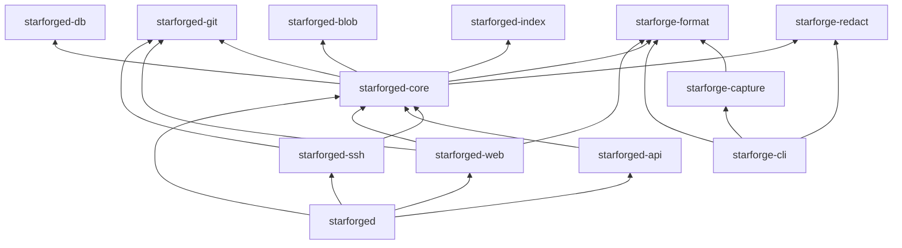

# Workspace crates

<!-- ste-sources
Cargo.toml
crates/starforge-capture
crates/starforge-cli
crates/starforge-format
crates/starforge-redact
crates/starforged-api
crates/starforged-blob
crates/starforged-core
crates/starforged-db
crates/starforged-git
crates/starforged-index
crates/starforged-ssh
crates/starforged-web
crates/starforged
crates/starforged/src/lib.rs
crates/starforged-core/src/lib.rs
-->

## Purpose

This page lists every crate in the workspace.
The workspace root declares `members` as `crates/*`.
The root file lives at `Cargo.toml`.
Each row states the job, modules, dependencies, and tests.

## Scope

This page covers crate boundaries only.
It does not describe behavior inside each crate.
Linked pages describe the behavior.
The [architecture page](architecture.md) describes the process model.
The [storage and database page](storage-and-database.md) describes stored state.

## Design

Server code and client code have different licenses.
The workspace package license is AGPL-3.0-or-later.
`publish` is false for every server crate.
The four client crates publish separately.
Those four crates use MIT OR Apache-2.0.
The split keeps the server under copyleft.

The client format stays reusable by other tools.

Jobs live in `starforged-core`.
No separate jobs crate exists.
`starforged-core/src/jobs.rs` owns the `Job` enum.
`start_workers` spawns the in-process workers.
The `starforged` binary calls `start_workers` at startup.

Dependency direction follows the layer rule.
`starforged-web` depends on `starforged-core`.
`starforged-api` depends on `starforged-core`.
`starforged-ssh` depends on `starforged-core`.
`starforged` depends on every server crate.
`starforged-core` depends on storage crates only.

`starforged-core` depends on `starforged-db`.
`starforged-core` depends on `starforged-git`.
`starforged-core` depends on `starforged-blob`.
`starforged-core` depends on `starforged-index`.
`starforged-core` also depends on the two client crates.
The client crates share Trace Format v1 and redaction rules.



## Interfaces

The table below is the reference for dependency review.
Relevant build files live in each crate directory.

| Crate | Job | Key modules | Main dependencies | Tests |
|---|---|---|---|---|
| `starforge-format` | Trace Format v1 encode | `agent`, `events`, `segments`, `session` | `blake3`, `serde`, `serde_json`, `ulid`, `zstd` | `tests/v1_fixtures.rs` |
| `starforge-redact` | Secret redaction engine | `detectors`, `json`, `rules` | `regex`, `blake3`, `starforge-format` | `tests/corpus.rs` |
| `starforge-capture` | Agent transcript adapters | `adapter`, `agents`, `cursor`, `discover` | `rusqlite`, `starforge-format` | `tests/` golden files |
| `starforge-cli` | `starforge` command client | `api`, `auth`, `cli`, `commands`, `discovery`, `git`, `hooks`, `ingest`, `queue`, `spool`, `upload` | `clap`, `reqwest`, `starforge-capture`, `starforge-format`, `starforge-redact` | `tests/` end to end |
| `starforged-core` | Domain rules and service layer | `accounts`, `jobs`, `mail`, `permission`, `ingest`, `trails`, `gitaccess`, `metrics` | `starforged-db`, `starforged-git`, `starforged-blob`, `starforged-index`, `starforge-format`, `starforge-redact`, `argon2`, `lettre` | `src/` unit tests |
| `starforged-db` | Relational persistence both engines | `audit`, `changes`, `jobs`, `repos`, `sessions`, `trails`, `users`, `web_sessions` | `sqlx`, `thiserror` | `src/` unit tests |
| `starforged-git` | Repositories on disk | `blame`, `command`, `diff`, `grep`, `http`, `init`, `merge`, `refpolicy`, `write` | `gix`, `tokio`, `serde` | `src/` unit tests |
| `starforged-ssh` | Git over SSH server | `command`, `server` | `russh`, `starforged-core`, `starforged-git` | `src/` unit tests |
| `starforged-web` | HTML pages and smart HTTP | `auth`, `error`, `githttp`, `highlight`, `markdown`, `pages`, `views` | `axum`, `askama`, `starforged-core`, `starforged-git`, `syntect` | `starforged/tests/` integration |
| `starforged-api` | JSON REST API | `admin`, `auth`, `changes`, `openapi`, `repos`, `sessions`, `trails` | `axum`, `utoipa`, `starforged-core` | `starforged/tests/` integration |
| `starforged-blob` | Content addressed blob store | `BlobStore`, `FsBlobStore`, `BlobError` | `blake3`, `tokio`, `thiserror` | `tests/store.rs` |
| `starforged-index` | Tantivy search index | `SearchIndex`, `TrailDoc`, `EventDoc` | `tantivy`, `thiserror` | `src/` unit tests |
| `starforged` | Server binary and setup | `admin`, `backup`, `config`, `doctor`, `hook`, `index_cmd`, `init`, `restore`, `serve` | `starforged-api`, `starforged-web`, `starforged-ssh`, `starforged-core`, `clap`, `axum` | `tests/` integration |

`starforge-format` defines `Event` and `SessionMeta`.
`starforge-format` also defines segment split and assemble.
`starforge-capture` normalizes native agent transcripts.
`starforge-capture` passes adapter roots as parameters.
The capture crate reads no environment variables.
The capture crate reads no clock values.

`starforge-cli` ships the `starforge` binary.
The CLI captures sessions and uploads segments.
The CLI manages hooks and the spool queue.
The CLI talks to a server over HTTPS.

`starforged` ships the `starforged` binary.
The library half builds the HTTP app in process.
`crates/starforged/src/lib.rs` exports each module.
Integration tests use that library surface.

## Failure behavior

The server never starts from a half wired dependency graph.
`starforged-core` has no upward dependency.
Lower crates never import `starforged-core`.
Any import reversal breaks the dependency direction.
Cargo rejects the import cycle at build time.
The license split isolates permissive client code.

The copyleft boundary sits at the server crate edge.

## Verification

Run the checker in the working directory:

```bash
python3 scripts/ste_check.py docs/technical/crates.md
```

Unit tests live in `src/` for most server crates.
Integration tests live in `crates/starforged/tests/`.
Client integration tests live in each client crate `tests/`.
The `testing` features expose test helpers.
`starforged-core` exposes `mail::testing` through `testing`.
`starforged-db` exposes `testing` helpers through `testing`.

## Related

- [architecture documentation](architecture.md)
- [configuration documentation](configuration.md)
- [storage and database documentation](storage-and-database.md)
- [git hosting documentation](git-hosting.md)
- [sessions documentation](sessions.md)
- [trace and redaction documentation](trace-and-redaction.md)
- [cli documentation](cli.md)
